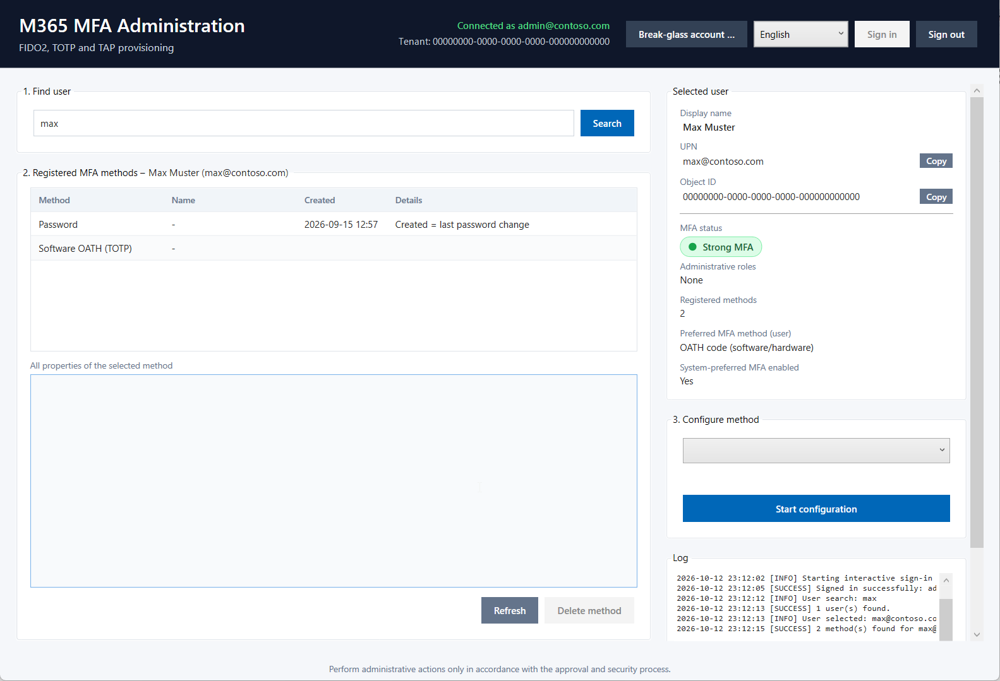
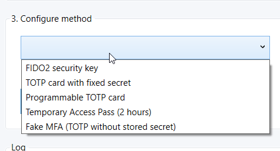
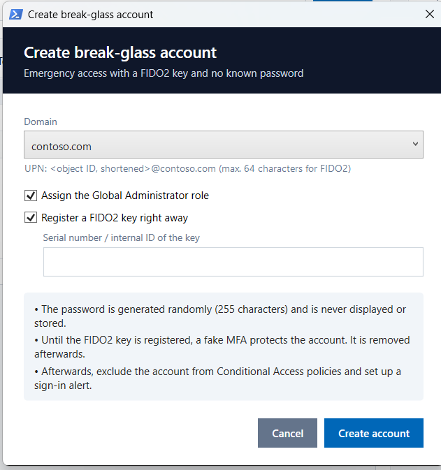
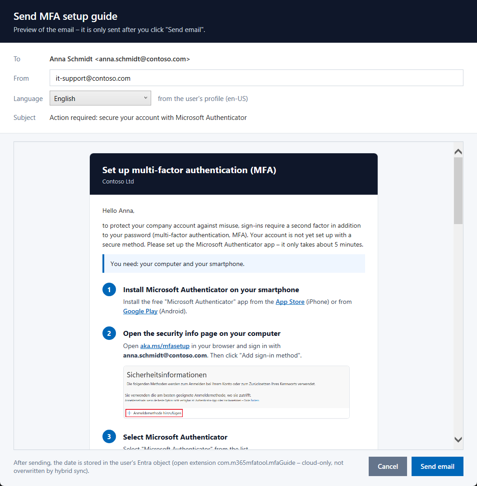
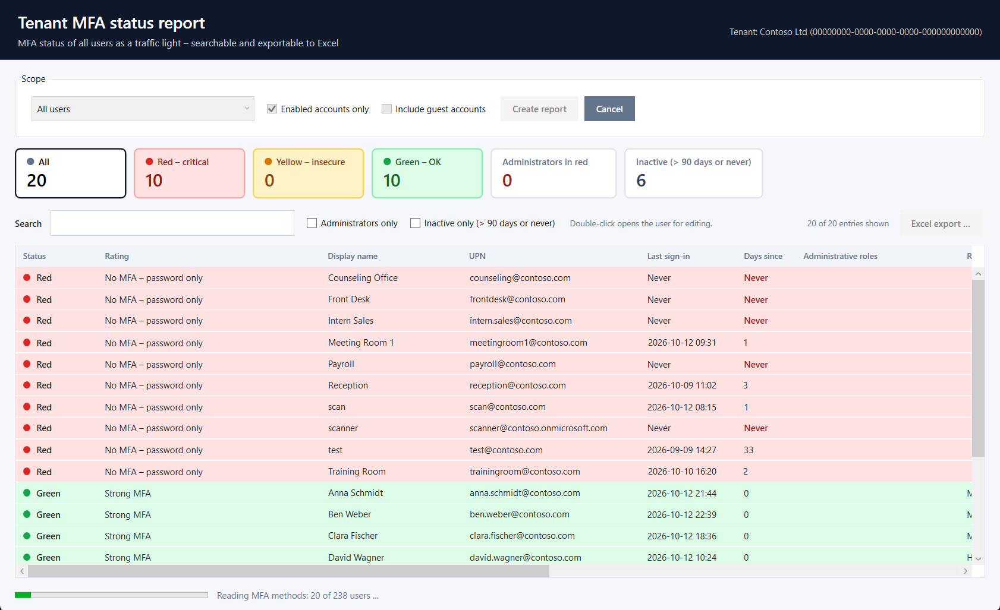

🌐 **English** · [Deutsch](docs/README.de.md) · [Español](docs/README.es.md) · [Français](docs/README.fr.md) · [Italiano](docs/README.it.md) · [Português](docs/README.pt.md) · [Nederlands](docs/README.nl.md) · [Polski](docs/README.pl.md)

# M365 MFA Administration Tool

With this tool, administrators and help desk staff set up **multi-factor authentication (MFA) on behalf of other users** – for example a FIDO2 key, a TOTP card or a temporary access code. It also shows at a glance how well a user account is protected.

## Contents

- [At a glance](#at-a-glance)
- [Quick start](#quick-start)
- [Step-by-step guide](#step-by-step-guide)
- [Which method when?](#which-method-when)
- [Create a break-glass account](#create-a-break-glass-account)
- [MFA setup guide by email](#mfa-setup-guide-by-email)
- [Tenant MFA report](#tenant-mfa-report)
- [FAQ and troubleshooting](#faq-and-troubleshooting)
- [Security](#security)
- [For administrators: requirements and permissions](#for-administrators-requirements-and-permissions)
- [Project structure](#project-structure)
- [Adding a language](#adding-a-language)

---

## At a glance

| | Feature |
|---|---|
| 🔍 | **Find users** – by name, email address, UPN or object ID |
| 🚦 | **MFA traffic light** – shows instantly whether an account is well, weakly or not protected, including a recommendation |
| 👑 | **Admin roles** – shows whether the user has administrative rights |
| 📋 | **View and delete MFA methods** – all registered methods with date and details |
| ➕ | **Set up methods** – FIDO2 key, TOTP cards, Temporary Access Pass and fake MFA |
| ✉️ | **MFA setup guide by email** – sends users without or with weak MFA a step-by-step guide for the Microsoft Authenticator app, in their language and with preview |
| 📊 | **Tenant MFA report** – MFA status and last sign-in of all users as a traffic light, with search, filters and colored Excel export |
| 🆘 | **Break-glass account** – create an emergency access account with a FIDO2 key and an unknown password |
| 🌐 | **Multilingual** – English (default), German, Spanish, French, Italian, Portuguese, Dutch and Polish |

---

## Quick start

1. Copy the entire folder to your computer (the files must stay together).
2. **Double-click `Start.cmd`.**
3. Click **"Sign in"** in the top right and sign in with your own admin account.

> [!TIP]
> For quick access, create a desktop shortcut to `Start.cmd` (right-click → *Create shortcut*).

On the first sign-in, the tool checks whether required components are missing. If so, it lists them and asks once whether to install them – the installation runs in the background (about one to two minutes) and is shown in the log. Microsoft then asks once for consent to the tool's permissions.

---

## Step-by-step guide

### 1. Choose a language and sign in

The interface starts in **English**. Use the selection box in the top right next to "Sign in" to switch the language at any time, e.g. to **German** – no restart needed. The choice is saved for your Windows user and applied on the next start.

Click **"Sign in"** in the top right. After a successful sign-in, it shows *"Connected as …"* in green along with the tenant. **"Sign out"** ends the session – this also happens automatically when the window is closed.

### 2. Find a user

In the **"1. Find user"** box, enter the beginning of a name, an email address or the UPN and press **Enter** (or click **"Search"**).

- **One result:** The user opens directly.
- **Several results:** A list drops down below the search box – click the user you want. Press **Esc** or click elsewhere to close the list.

### 3. Understand the MFA status

On the right under **"Selected user"**, the **MFA traffic light** shows how well the account is protected:

| Traffic light | Meaning | What to do? |
|---|---|---|
| 🟢 **Strong MFA (phishing-resistant)** | FIDO2 key, passkey or Windows Hello present | All good. |
| 🟢 **Strong MFA** | Authenticator app or TOTP card/app present | Fine. For administrators, FIDO2 is also recommended. |
| 🟡 **Weak MFA only** | Only SMS or phone call | Set up a better method, then remove SMS/call. |
| 🟡 **Fake MFA only** | Account is locked down (see [fake MFA](#which-method-when)) | Set up a real method for use. |
| 🟡 **Temporary Access Pass only** | Only a temporary access code | The user should now use it to set up a permanent method. |
| 🔴 **No MFA – password only** | No second factor | Set up a method urgently. |

Below the traffic light you will find specific recommendations, e.g. *"SMS/call is also registered and can be removed"*.

Further down, **"Administrative roles"** shows whether the user has admin rights. Click **"Show"** to expand the list. For each role it also shows whether it is permanently active, assigned via a group or only activatable via PIM.

### 4. View and delete MFA methods

On the left under **"2. Registered MFA methods"** you see all methods of the user. Clicking a method shows **all details** below it (e.g. device model, serial number, creation date).

To delete a method, select it and click **"Delete method"**. A confirmation prompt appears before deletion. The password cannot be deleted.

> [!NOTE]
> Microsoft applies changes with a delay of a few seconds. The tool automatically waits until the list shows the new state. If needed, click **"Refresh"**.

### 5. Set up a new method

On the right under **"3. Configure method"**, select the method you want:

Depending on the method, matching input fields (e.g. the serial number) and a short hint appear. Then click **"Start configuration"** and confirm the prompt. The result appears in the **log** and the method list is refreshed automatically.

---

## Which method when?

| Method | When to use? | What happens? |
|---|---|---|
| **FIDO2 security key** | The user gets a FIDO2 key (e.g. YubiKey). The most secure method – especially for administrators. | Plug in the key and enter the serial number. Windows asks for the key's **PIN** and to **touch** it. The key is then named `FIDO2-<serial number>`. |
| **TOTP card with fixed secret** | The user gets a code card whose secret key was supplied by the manufacturer. | Enter the serial number and secret. The card is created, assigned to the user and activated immediately. |
| **Programmable TOTP card** | The user gets a code card that you program yourself (e.g. with the manufacturer's app). | Enter the serial number. The tool generates a new secret and shows the **QR code and secret**. Use them to program the card, then close the display with ✕. |
| **Temporary Access Pass (TAP)** | The user should set up the Authenticator or a passkey themselves but has no method yet – or has lost their method. | A code is generated, **valid immediately for 2 hours** and usable multiple times. It is shown in large type in a yellow box and can be copied. An existing TAP is replaced. |
| **Fake MFA** | An account that nobody uses (yet) should be protected – e.g. a new break-glass or service account. | A code method is registered whose key is destroyed immediately. MFA is required at sign-in that nobody can satisfy – this protects the account. |

> [!IMPORTANT]
> **TAPs, secrets and QR codes are shown only once.** They are not written to the log and cannot be retrieved later. If a QR code is saved via "Save QR code …", the file contains the secret – please delete it after programming.

---

## Create a break-glass account

A **break-glass account** is an emergency access account that still gets you into the tenant when normal admin access fails (e.g. due to a faulty Conditional Access policy).

Click **"Break-glass account …"** in the top right:

1. Select the **domain** in which the account is created.
2. Decide whether the account gets the **Global Administrator** role (recommended, preselected).
3. Plug in the **FIDO2 key** and enter its serial number.
4. Click **"Create account"**.

The tool then automatically:

- creates the account with a **random password** (255 characters – it is never displayed or stored anywhere, nobody knows it)
- changes the account name to the unique object ID
- assigns the Global Administrator role
- immediately protects the account with **fake MFA**
- **registers the FIDO2 key** (Windows asks for PIN and touch) and then removes the fake MFA again

At the end, a summary shows what was done, and the new account is displayed directly.

> [!WARNING]
> **Then complete manually:**
> - **Exclude** the account **from all Conditional Access policies**.
> - Set up a **sign-in alert** so that every use is noticed.
> - Store the FIDO2 key securely (e.g. in a safe).

If FIDO2 registration fails or is cancelled, the account stays protected with fake MFA. The key can be added later via **"3. Configure method → FIDO2 security key"**.

---

## MFA setup guide by email

If a user has **no MFA or only weak MFA** (traffic light red or yellow), the button **"Send setup guide …"** appears next to the MFA status. It sends the user an email with a simple step-by-step guide: open aka.ms/mfasetup, add the Microsoft Authenticator app, scan the QR code. If the user cannot or does not want to use the app, the email asks them to contact the IT department – simply by replying to the email.

- **Preview first:** the email is shown exactly as it will be sent. It is only sent after **"Send email"** and a confirmation.
- **Language of the user:** the email is written in the user's preferred language from Entra ID (otherwise the tenant language, otherwise English) and can be changed in the preview.
- **Sender:** by default your own mailbox. You can enter a shared mailbox (e.g. the IT mailbox) for which you have *Send As* permission – replies then go there. The last sender is remembered.
- **Images:** the screenshots are embedded in the email as inline attachments (Base64) – nothing is loaded from the internet, and they are displayed in Outlook too.
- **Sending date in the user object:** after sending, date, sender and language are stored in an open extension of the user (`com.m365mfatool.mfaGuide`). Open extensions exist only in Entra ID: they are writable for synchronized (hybrid) users too and are never overwritten by Entra Connect / Cloud Sync – unlike `extensionAttribute1–15`. The date is shown below the traffic light and in the tenant MFA report (column **"Guide sent"**).
- **Sending history (count and times):** a second open extension `com.m365mfatool.mfaGuideHistory` counts every sending (`sentCount`) and keeps the times of the last 20 sendings with sender and language (`entries`, plus `firstSentDateTime`/`lastSentDateTime`). The history is shown as a tooltip on the guide status and in the tenant MFA report (column **"Count"**, tooltip on **"Guide sent"**). hrdnr reads and writes the same extension, so both tools show the same history.

The smartphone screenshots in the email come from the Microsoft documentation (MicrosoftDocs/entra-docs, MIT license); all screenshots are anonymized.

---

## Tenant MFA report

Click **"MFA report …"** in the top left to check the MFA status of **all users of the tenant** (or of the members of a group, incl. nested groups) at once.

1. Choose the scope: **All users** or **Members of a group** (find the group by the beginning of its name or by object ID). By default, only enabled accounts and no guest accounts are included.
2. Click **"Create report"**. The list fills up while the methods are being read (20 users per Graph request). **"Cancel"** stops after the current block.
3. The tiles show the number per traffic light color – **clicking a tile filters** the list. In addition, you can **search** (name, UPN, email, roles, methods, rating, department) and show **administrators only**.
   The columns **Last sign-in** and **Days since** show whether an account is actually used. Accounts without a sign-in for more than 90 days or that never signed in are highlighted in red, counted in a separate tile and can be shown with **Inactive only**.
4. **"Excel export …"** saves the entries currently shown as an `.xlsx` file in traffic light colors, including a summary sheet. Neither Excel nor an extra module is required.
5. **Double-clicking** a user closes the report and opens the user in the main window for editing. The report is kept until you sign out.

| Traffic light | Meaning |
|---|---|
| 🔴 **Red** | No MFA (password only), **or** administrative role with insecure MFA only (SMS/call, TAP or fake MFA) |
| 🟡 **Yellow** | Insecure MFA only (SMS/call, TAP or fake MFA), **or** administrator without phishing-resistant MFA (FIDO2, passkey, Windows Hello) |
| 🟢 **Green** | Strong MFA – for administrators phishing-resistant |

Administrative roles include active and PIM-eligible roles (marked "(PIM)") as well as roles assigned via groups.

---

## FAQ and troubleshooting

**Double-clicking `Start.cmd` does nothing or shows an error.**
The tool only runs on Windows. If the folder was copied from the internet, Teams or a ZIP file, the files may be blocked. Run this once in PowerShell inside the folder: `Get-ChildItem -Recurse | Unblock-File`.

**Sign-in asks for consent again.**
This is normal when a new feature needs additional permissions – for example the first break-glass account.

**A newly created or deleted method does not show up immediately.**
Microsoft needs a few seconds for this. The tool automatically waits up to approx. 16 seconds; afterwards click **"Refresh"** if needed.

**FIDO2: "Fido credential policy …" or "not enabled".**
FIDO2 is not enabled in the tenant. An administrator must enable it in the authentication methods policy (see [requirements](#for-administrators-requirements-and-permissions)).

**FIDO2: "The UPN is too long".**
FIDO2 allows a maximum of 64 characters for the sign-in name (UPN).

**TOTP card: "A token with serial number … is already assigned to …".**
The card already belongs to another user. Remove it there first.

**Error message with "Authorization_RequestDenied" or "Forbidden".**
Your account is missing an admin role (see [roles](#for-administrators-requirements-and-permissions)).

Every action is listed with its time in the **log** at the bottom right. It is also saved immediately to a daily log file in the tool folder, e.g. `Logs\2026-10-12.log` (if the folder is not writable: `%LOCALAPPDATA%\M365MfaTool\Logs`) – helpful for questions.

**MFA report: the last sign-in columns are empty.**
This requires an **Entra ID P1/P2** license, the `AuditLog.Read.All` permission and a role that may read sign-in data (e.g. **Reports Reader**). Without them, the report is still created, just without this information; the log shows the reason.

---

## Security

- **No secrets in the log:** TAPs, secrets and passwords are never logged or saved to disk.
- **Unknown passwords:** Break-glass passwords are generated randomly and never displayed.
- **Confirmation prompts:** Every change must be confirmed; the prompts default to "No".
- **Clean-up on errors:** If setting up a TOTP card fails, the tool automatically removes half-created entries.

> [!CAUTION]
> Only perform administrative actions in accordance with your internal approval and security process.

---

## For administrators: requirements and permissions

### System requirements

- Windows with **Windows PowerShell 5.1** (preinstalled; PowerShell 7 is not supported because the interface uses WPF)
- Internet access on first start to install the PowerShell modules (for the current user only, no admin rights required):
  - `Microsoft.Graph.Authentication`
  - `Microsoft.Graph.Identity.SignIns` and `DSInternals.Passkeys` **1.0.6** (FIDO2)
  - `QRCodeGenerator` (QR codes for programmable TOTP cards)

  Alternatively, install them in advance with `Install-Prerequisites.ps1`.
- For FIDO2, the key must be connected to the **local computer** (via RDP only with WebAuthn redirection).

### Graph permissions (delegated)

At sign-in:

| Permission | Purpose |
|---|---|
| `User.Read.All` | Find users |
| `UserAuthenticationMethod.Read.All` | Show MFA methods |
| `UserAuthenticationMethod.ReadWrite.All` | Set up and delete MFA methods |
| `Policy.ReadWrite.AuthenticationMethod` | Create/delete TOTP cards and fake MFA in the token inventory |
| `RoleManagement.Read.Directory` | Show a user's admin roles |

Additionally for the first break-glass account:

| Permission | Purpose |
|---|---|
| `User.ReadWrite.All` | Create users |
| `Domain.Read.All` | Show domains for selection |
| `RoleManagement.ReadWrite.Directory` | Assign Global Administrator |

Additionally for the tenant MFA report:

| Permission | Purpose |
|---|---|
| `GroupMember.Read.All` | Select a group as scope, resolve admin roles assigned via groups |
| `AuditLog.Read.All` | Last sign-in (optional – without it, the report is created without this column) |

The last sign-in additionally requires an **Entra ID P1/P2** license and a role that may read sign-in data, e.g. **Reports Reader**, **Security Reader** or **Global Reader**. It shows the last successful sign-in (interactive or non-interactive); Microsoft records this since December 2023, older values are the last sign-in attempt.

Additionally for the MFA setup guide:

| Permission | Purpose |
|---|---|
| `Mail.Send` | Send the email from your own mailbox |
| `Mail.Send.Shared` | Send the email from a shared mailbox (only if one is entered) |
| `User.ReadWrite.All` | Store the sending date in the user object |

Storing the sending date requires a role that may update users, e.g. **User Administrator**.

### Required Entra roles for your own account

| Task | Role |
|---|---|
| Manage methods of regular users, TAP | **Authentication Administrator** |
| Manage methods of administrators | **Privileged Authentication Administrator** |
| TOTP cards and fake MFA | additionally **Authentication Policy Administrator** |
| Break-glass account | **Global Administrator** (or Privileged Role Administrator + User Administrator) |

### Tenant settings

In the **authentication methods policy** (Entra admin center → Protection → Authentication methods), the methods used must be enabled:

- **Passkey (FIDO2)**
- **Hardware OATH tokens** (for TOTP cards and fake MFA)
- **Temporary Access Pass** – maximum lifetime at least 2 hours

### Notes

- Some features use the **beta API** of Microsoft Graph (e.g. for hardware OATH tokens), which may change.
- PIM-eligible roles are only shown with Entra ID P2.
- The selected language is stored in `%APPDATA%\M365MfaTool\settings.json`.

---

## Project structure

| File | Content |
|---|---|
| `Start.cmd` | Launcher for double-click |
| `Start-M365MfaTool.ps1` | User interface, state management and events |
| `UI/MainWindow.xaml` | Main window layout |
| `UI/BreakGlassDialog.xaml` | Dialog for new break-glass accounts |
| `UI/TenantReportWindow.xaml` | Window of the tenant MFA report |
| `UI/MfaGuideDialog.xaml` | Preview dialog of the MFA setup guide |
| `Modules/Graph.psm1` | Sign-in, Graph requests, users, domains, roles, MFA traffic light, reading/deleting methods |
| `Modules/Provisioning.psm1` | Setup of FIDO2, TOTP cards, fake MFA, TAP and break-glass accounts |
| `Modules/TenantReport.psm1` | Tenant MFA report: users, roles, batched method queries, traffic light rating, Excel export |
| `Modules/Xlsx.psm1` | Minimal Excel writer (.xlsx without Excel or additional modules) |
| `Modules/MfaGuideMail.psm1` | MFA setup guide: email in the user's language, sending via Graph, sending date in the user object |
| `Modules/Localization.psm1` | Localization: loads the language files and provides the texts |
| `Languages/*.json` | Texts per language (`en.json` is the reference) |
| `Mail/Images/` | Anonymized screenshots for the email |
| `Install-Prerequisites.ps1` | Optional advance installation of all modules |
| `docs/` | Translated documentation and screenshots |
| `Logs/` | Daily log files (created automatically, not stored in Git) |

---

## Adding a language

1. Copy `Languages/en.json` and name it after the language code, e.g. `sv.json` for Swedish.
2. Set `"_language"` to the name of the language in that language (e.g. `"Svenska"`) and translate all texts. Placeholders such as `{0}` must be kept.
3. Restart the tool – the language appears automatically in the selection. Missing texts are shown in English.
4. Optional: add a translated documentation as `docs/README.<code>.md` and link it in the language bar at the top of all README files.
