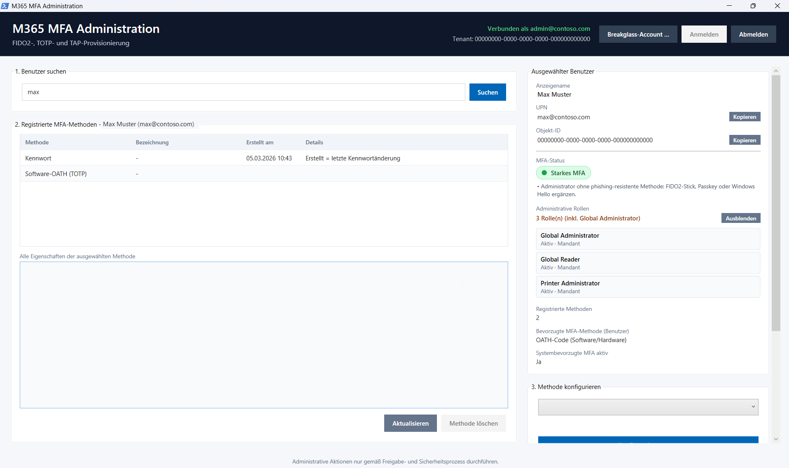
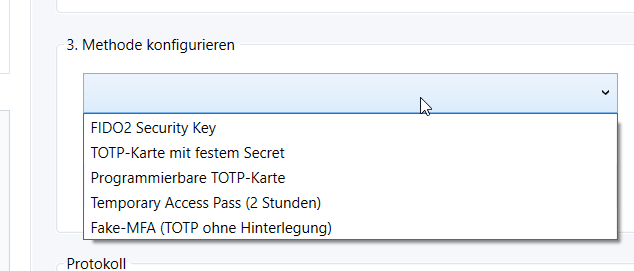
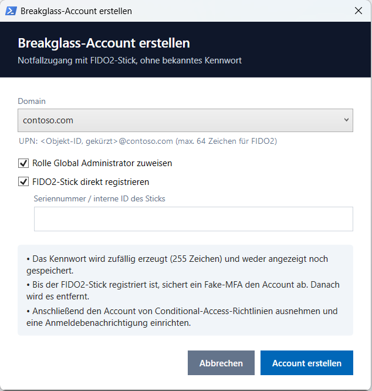
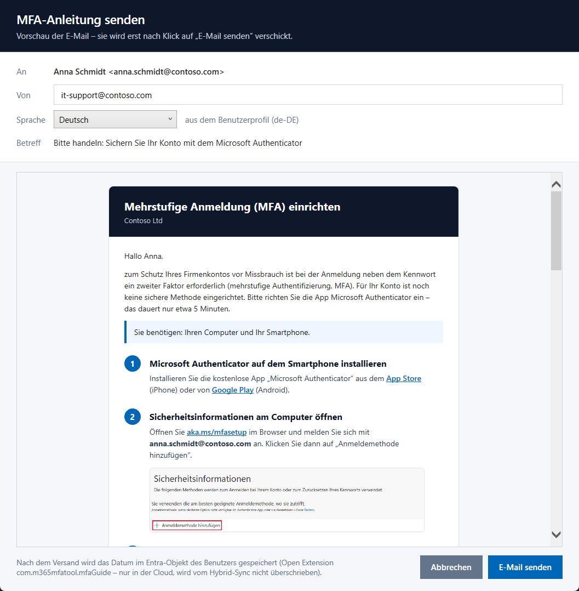
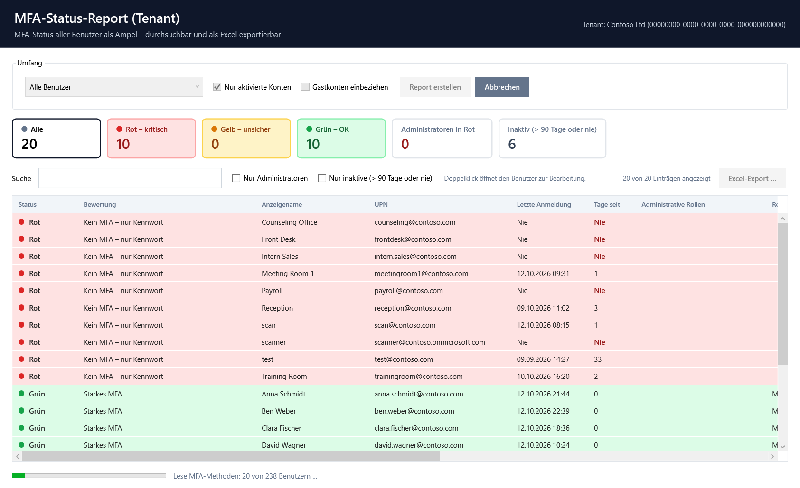

🌐 [English](../README.md) · **Deutsch** · [Español](README.es.md) · [Français](README.fr.md) · [Italiano](README.it.md) · [Português](README.pt.md) · [Nederlands](README.nl.md) · [Polski](README.pl.md)

# M365 MFA Administration Tool

Mit diesem Tool richten Administratoren und Helpdesk-Mitarbeitende **Multi-Faktor-Authentifizierung (MFA) im Namen anderer Benutzer** ein – zum Beispiel einen FIDO2-Stick, eine TOTP-Karte oder einen befristeten Zugangscode. Außerdem zeigt es auf einen Blick, wie gut ein Benutzerkonto abgesichert ist.

## Inhalt

- [Auf einen Blick](#auf-einen-blick)
- [Schnellstart](#schnellstart)
- [Bedienung Schritt für Schritt](#bedienung-schritt-für-schritt)
- [Welche Methode wann?](#welche-methode-wann)
- [Breakglass-Account erstellen](#breakglass-account-erstellen)
- [MFA-Anleitung per E-Mail](#mfa-anleitung-per-e-mail)
- [MFA-Report für den Tenant](#mfa-report-für-den-tenant)
- [Häufige Fragen und Fehlerbehebung](#häufige-fragen-und-fehlerbehebung)
- [Sicherheit](#sicherheit)
- [Für Administratoren: Voraussetzungen und Berechtigungen](#für-administratoren-voraussetzungen-und-berechtigungen)
- [Aufbau des Projekts](#aufbau-des-projekts)
- [Weitere Sprache hinzufügen](#weitere-sprache-hinzufügen)

---

## Auf einen Blick

| | Funktion |
|---|---|
| 🔍 | **Benutzer suchen** – nach Name, E-Mail-Adresse, UPN oder Objekt-ID |
| 🚦 | **MFA-Ampel** – zeigt sofort, ob ein Konto gut, schwach oder gar nicht abgesichert ist, inklusive Empfehlung |
| 👑 | **Admin-Rollen** – zeigt, ob der Benutzer administrative Rechte hat |
| 📋 | **MFA-Methoden ansehen und löschen** – alle registrierten Methoden mit Datum und Details |
| ➕ | **Methoden einrichten** – FIDO2-Stick, TOTP-Karten, Temporary Access Pass und Fake-MFA |
| ✉️ | **MFA-Anleitung per E-Mail** – schickt Benutzern ohne oder mit schwachem MFA eine Schritt-für-Schritt-Anleitung für die Microsoft Authenticator App, in ihrer Sprache und mit Vorschau |
| 📊 | **MFA-Report für den Tenant** – MFA-Status und letzte Anmeldung aller Benutzer als Ampel, mit Suche, Filtern und farbigem Excel-Export |
| 🆘 | **Breakglass-Account** – Notfallzugang mit FIDO2-Stick und unbekanntem Kennwort anlegen |
| 🌐 | **Mehrsprachig** – Englisch (Standard), Deutsch, Spanisch, Französisch, Italienisch, Portugiesisch, Niederländisch und Polnisch |

---

## Schnellstart

1. Den kompletten Ordner auf den eigenen Rechner kopieren (die Dateien müssen zusammenbleiben).
2. **`Start.cmd` doppelklicken.**
3. Oben rechts die Sprache auf **Deutsch** stellen und auf **„Anmelden“** klicken. Mit dem eigenen Admin-Konto anmelden.

> [!TIP]
> Für den schnellen Zugriff einfach eine Desktop-Verknüpfung auf `Start.cmd` anlegen (Rechtsklick → *Verknüpfung erstellen*).

Bei der ersten Anmeldung prüft das Tool, ob benötigte Komponenten fehlen. Falls ja, listet es sie auf und fragt einmalig, ob sie installiert werden sollen – die Installation läuft im Hintergrund (etwa ein bis zwei Minuten) und wird im Protokoll angezeigt. Danach fragt Microsoft einmalig nach der Zustimmung zu den Berechtigungen des Tools.

---

## Bedienung Schritt für Schritt

### 1. Sprache wählen und anmelden

Die Oberfläche startet auf **Englisch**. Über das Auswahlfeld oben rechts neben „Sign in“ lässt sich die Sprache jederzeit umstellen, zum Beispiel auf **Deutsch** – ohne Neustart. Die Auswahl wird für den eigenen Windows-Benutzer gespeichert und beim nächsten Start übernommen.

Oben rechts auf **„Anmelden“** klicken. Nach erfolgreicher Anmeldung steht dort in Grün *„Verbunden als …“* und der Tenant. Mit **„Abmelden“** wird die Sitzung beendet – das passiert auch automatisch beim Schließen des Fensters.

### 2. Benutzer suchen

Im Feld **„1. Benutzer suchen“** den Anfang eines Namens, einer E-Mail-Adresse oder des UPN eingeben und **Enter** drücken (oder auf **„Suchen“** klicken).

- **Ein Treffer:** Der Benutzer wird direkt geöffnet.
- **Mehrere Treffer:** Eine Liste klappt unter dem Suchfeld auf – den gewünschten Benutzer anklicken. Mit **Esc** oder einem Klick daneben schließt sich die Liste wieder.

### 3. MFA-Status verstehen

Rechts unter **„Ausgewählter Benutzer“** zeigt die **MFA-Ampel**, wie gut das Konto abgesichert ist:

| Ampel | Bedeutung | Was tun? |
|---|---|---|
| 🟢 **Starkes MFA (phishing-resistent)** | FIDO2-Stick, Passkey oder Windows Hello vorhanden | Alles in Ordnung. |
| 🟢 **Starkes MFA** | Authenticator-App oder TOTP-Karte/-App vorhanden | In Ordnung. Für Administratoren zusätzlich FIDO2 empfohlen. |
| 🟡 **Nur schwaches MFA** | Nur SMS oder Anruf | Bessere Methode einrichten, danach SMS/Anruf entfernen. |
| 🟡 **Nur Fake-MFA** | Konto ist gesperrt abgesichert (siehe [Fake-MFA](#welche-methode-wann)) | Für die Nutzung eine echte Methode einrichten. |
| 🟡 **Nur Temporary Access Pass** | Nur ein befristeter Zugangscode | Benutzer soll damit jetzt eine dauerhafte Methode einrichten. |
| 🔴 **Kein MFA – nur Kennwort** | Keine zweite Absicherung | Dringend eine Methode einrichten. |

Unter der Ampel stehen konkrete Empfehlungen, zum Beispiel *„SMS/Anruf ist zusätzlich registriert und kann entfernt werden“*.

Darunter zeigt **„Administrative Rollen“**, ob der Benutzer Admin-Rechte hat. Mit **„Anzeigen“** klappt die Liste auf. Dort steht pro Rolle auch, ob sie dauerhaft aktiv ist, über eine Gruppe vergeben wurde oder nur über PIM aktiviert werden kann.

### 4. MFA-Methoden ansehen und löschen

Links unter **„2. Registrierte MFA-Methoden“** stehen alle Methoden des Benutzers. Ein Klick auf eine Methode zeigt darunter **alle Details** (z. B. Gerätemodell, Seriennummer, Erstellungsdatum).

Zum Löschen eine Methode auswählen und auf **„Methode löschen“** klicken. Vor dem Löschen erscheint eine Sicherheitsabfrage. Das Kennwort kann nicht gelöscht werden.

> [!NOTE]
> Microsoft übernimmt Änderungen mit wenigen Sekunden Verzögerung. Das Tool wartet automatisch, bis die Liste den neuen Stand zeigt. Bei Bedarf hilft **„Aktualisieren“**.

### 5. Neue Methode einrichten

Rechts unter **„3. Methode konfigurieren“** die gewünschte Methode auswählen:

Je nach Methode erscheinen passende Eingabefelder (z. B. die Seriennummer) und ein kurzer Hinweis. Dann auf **„Konfiguration starten“** klicken und die Sicherheitsabfrage bestätigen. Das Ergebnis erscheint im **Protokoll** und die Methodenliste wird automatisch aktualisiert.

---

## Welche Methode wann?

| Methode | Wann verwenden? | Was passiert? |
|---|---|---|
| **FIDO2 Security Key** | Der Benutzer bekommt einen FIDO2-Stick (z. B. YubiKey). Die sicherste Methode – besonders für Administratoren. | Stick anstecken und Seriennummer eingeben. Windows fragt nach der **PIN** des Sticks und bittet, ihn zu **berühren**. Der Stick heißt danach `FIDO2-<Seriennummer>`. |
| **TOTP-Karte mit festem Secret** | Der Benutzer bekommt eine Code-Karte, deren Geheimschlüssel (Secret) vom Hersteller mitgeliefert wurde. | Seriennummer und Secret eingeben. Die Karte wird angelegt, dem Benutzer zugewiesen und sofort aktiviert. |
| **Programmierbare TOTP-Karte** | Der Benutzer bekommt eine Code-Karte, die man selbst programmiert (z. B. per Hersteller-App). | Seriennummer eingeben. Das Tool erzeugt ein neues Secret und zeigt **QR-Code und Secret** an. Damit die Karte programmieren, danach die Anzeige mit ✕ schließen. |
| **Temporary Access Pass (TAP)** | Der Benutzer soll sich selbst den Authenticator oder einen Passkey einrichten, hat aber noch keine Methode. Oder: Methode verloren. | Ein Code wird erzeugt, **ab sofort 2 Stunden gültig** und mehrfach nutzbar. Er erscheint groß in einem gelben Kasten und kann kopiert werden. Ein vorhandener TAP wird ersetzt. |
| **Fake-MFA** | Ein Konto soll abgesichert werden, das (noch) niemand aktiv nutzt – z. B. ein neuer Breakglass- oder Dienst-Account. | Es wird eine Code-Methode registriert, deren Schlüssel sofort vernichtet wird. Bei der Anmeldung wird MFA verlangt, das niemand erfüllen kann – das Konto ist dadurch geschützt. |

> [!IMPORTANT]
> **TAP, Secrets und QR-Codes werden nur ein einziges Mal angezeigt.** Sie stehen nicht im Protokoll und können später nicht erneut abgerufen werden. Wird ein QR-Code über „QR-Code speichern …“ gesichert, enthält die Datei das Secret – nach dem Programmieren bitte löschen.

---

## Breakglass-Account erstellen

Ein **Breakglass-Account** ist ein Notfallzugang, mit dem man auch dann noch in den Tenant kommt, wenn normale Admin-Zugänge nicht funktionieren (z. B. bei einer fehlerhaften Conditional-Access-Richtlinie).

Oben rechts auf **„Breakglass-Account …“** klicken:

1. **Domain** auswählen, unter der das Konto angelegt wird.
2. Festlegen, ob das Konto die Rolle **Global Administrator** bekommt (empfohlen, vorausgewählt).
3. Den **FIDO2-Stick** anstecken und seine Seriennummer eingeben.
4. Auf **„Account erstellen“** klicken.

Das Tool erledigt danach automatisch:

- Konto mit einem **zufälligen Kennwort** anlegen (255 Zeichen – es wird nirgends angezeigt oder gespeichert, niemand kennt es)
- Kontoname auf die eindeutige Objekt-ID umstellen
- Rolle Global Administrator zuweisen
- Konto sofort mit **Fake-MFA** absichern
- **FIDO2-Stick registrieren** (Windows fragt nach PIN und Berührung) und danach das Fake-MFA wieder entfernen

Am Ende zeigt eine Zusammenfassung, was erledigt wurde, und das neue Konto wird direkt angezeigt.

> [!WARNING]
> **Danach noch manuell erledigen:**
> - Den Account von **allen Conditional-Access-Richtlinien ausnehmen**.
> - Eine **Benachrichtigung bei Anmeldung** einrichten, damit jede Nutzung auffällt.
> - Den FIDO2-Stick sicher verwahren (z. B. im Tresor).

Falls die FIDO2-Registrierung fehlschlägt oder abgebrochen wird, bleibt das Konto mit Fake-MFA abgesichert. Der Stick kann später über **„3. Methode konfigurieren → FIDO2 Security Key“** nachgetragen werden.

---

## MFA-Anleitung per E-Mail

Hat ein Benutzer **kein oder nur schwaches MFA** (Ampel rot oder gelb), erscheint neben dem MFA-Status der Button **"Anleitung senden …"**. Er schickt dem Benutzer eine E-Mail mit einer einfachen Schritt-für-Schritt-Anleitung: aka.ms/mfasetup öffnen, die App Microsoft Authenticator hinzufügen, QR-Code scannen. Kann oder möchte der Benutzer die App nicht nutzen, bittet die E-Mail ihn, sich bei der IT-Abteilung zu melden – einfach per Antwort auf die E-Mail.

- **Erst Vorschau:** Die E-Mail wird genau so angezeigt, wie sie verschickt wird. Gesendet wird erst nach **"E-Mail senden"** und einer Bestätigung.
- **Sprache des Benutzers:** Die E-Mail wird in der bevorzugten Sprache des Benutzers aus Entra ID geschrieben (sonst in der Sprache des Tenants, sonst Englisch) und lässt sich in der Vorschau ändern.
- **Absender:** Standardmäßig das eigene Postfach. Alternativ ein freigegebenes Postfach (z. B. das IT-Postfach), für das Sie die Berechtigung *Senden als* haben – Antworten landen dann dort. Der zuletzt verwendete Absender wird gespeichert.
- **Bilder:** Die Screenshots sind als Inline-Anhänge (Base64) in die E-Mail eingebettet – es wird nichts aus dem Internet nachgeladen, und sie werden auch in Outlook angezeigt.
- **Versanddatum im Benutzerobjekt:** Nach dem Versand werden Datum, Absender und Sprache in einer Open Extension des Benutzers gespeichert (`com.m365mfatool.mfaGuide`). Open Extensions gibt es nur in Entra ID: Sie sind auch bei synchronisierten (hybriden) Benutzern beschreibbar und werden von Entra Connect / Cloud Sync nie überschrieben – anders als `extensionAttribute1–15`. Das Datum wird unter der Ampel und im MFA-Report (Spalte **"Anleitung gesendet"**) angezeigt.

Die Smartphone-Screenshots in der E-Mail stammen aus der Microsoft-Dokumentation (MicrosoftDocs/entra-docs, MIT-Lizenz); alle Screenshots sind anonymisiert.

---

## MFA-Report für den Tenant

Über **„MFA-Report …“** oben links prüfen Sie den MFA-Status **aller Benutzer des Tenants** (oder der Mitglieder einer Gruppe inkl. verschachtelter Gruppen) auf einen Blick.

1. Umfang wählen: **Alle Benutzer** oder **Mitglieder einer Gruppe** (Gruppe über den Namensanfang oder die Objekt-ID suchen). Standardmäßig werden nur aktivierte Konten und keine Gastkonten berücksichtigt.
2. **„Report erstellen“** klicken. Die Liste füllt sich, während die Methoden gelesen werden (20 Benutzer je Graph-Anfrage). **„Abbrechen“** stoppt nach dem aktuellen Block.
3. Die Kacheln zeigen die Anzahl je Ampelfarbe – **ein Klick auf eine Kachel filtert** die Liste. Zusätzlich können Sie **suchen** (Name, UPN, E-Mail, Rollen, Methoden, Bewertung, Abteilung) und **nur Administratoren** anzeigen.
   Die Spalten **Letzte Anmeldung** und **Tage seit** zeigen, ob ein Konto tatsächlich genutzt wird. Konten ohne Anmeldung seit mehr als 90 Tagen oder ohne jede Anmeldung werden rot hervorgehoben, in einer eigenen Kachel gezählt und lassen sich mit **Nur inaktive** anzeigen.
4. **„Excel-Export …“** speichert die aktuell angezeigten Einträge als `.xlsx` in Ampelfarben, inklusive Blatt „Zusammenfassung“. Weder Excel noch ein Zusatzmodul ist nötig.
5. **Doppelklick** auf einen Benutzer schließt den Report und öffnet den Benutzer im Hauptfenster zur Bearbeitung. Der Report bleibt bis zur Abmeldung erhalten.

| Ampel | Bedeutung |
|---|---|
| 🔴 **Rot** | Kein MFA (nur Kennwort) **oder** Admin-Rolle mit nur unsicherem MFA (SMS/Anruf, TAP oder Fake-MFA) |
| 🟡 **Gelb** | Nur unsicheres MFA (SMS/Anruf, TAP oder Fake-MFA) **oder** Administrator ohne phishing-resistentes MFA (FIDO2, Passkey, Windows Hello) |
| 🟢 **Grün** | Starkes MFA – bei Administratoren phishing-resistent |

Als administrative Rollen zählen aktive und PIM-berechtigte Rollen (markiert mit „(PIM)“) sowie Rollen, die über Gruppen zugewiesen sind.

---

## Häufige Fragen und Fehlerbehebung

**Beim Doppelklick auf `Start.cmd` passiert nichts oder es erscheint eine Fehlermeldung.**
Das Tool läuft nur unter Windows. Wurde der Ordner aus dem Internet, Teams oder einer ZIP-Datei kopiert, sind die Dateien eventuell blockiert. In PowerShell im Ordner einmal ausführen: `Get-ChildItem -Recurse | Unblock-File`.

**Die Anmeldung fragt erneut nach Zustimmung.**
Das ist normal, wenn eine neue Funktion zusätzliche Berechtigungen braucht – zum Beispiel beim ersten Breakglass-Account.

**Eine neu angelegte oder gelöschte Methode wird nicht sofort angezeigt.**
Microsoft braucht dafür einige Sekunden. Das Tool wartet automatisch bis zu ca. 16 Sekunden; danach ggf. **„Aktualisieren“** klicken.

**FIDO2: „Fido credential policy …“ oder „nicht aktiviert“.**
FIDO2 ist im Tenant nicht freigeschaltet. Ein Administrator muss es in den Authentifizierungsmethoden-Richtlinien aktivieren (siehe [Voraussetzungen](#für-administratoren-voraussetzungen-und-berechtigungen)).

**FIDO2: „Der UPN ist zu lang“.**
Für FIDO2 darf der Anmeldename (UPN) maximal 64 Zeichen haben.

**TOTP-Karte: „Ein Token mit der Seriennummer … ist bereits … zugewiesen“.**
Die Karte gehört schon einem anderen Benutzer. Dort zuerst entfernen.

**Fehlermeldung mit „Authorization_RequestDenied“ oder „Forbidden“.**
Dem eigenen Konto fehlt eine Admin-Rolle (siehe [Rollen](#für-administratoren-voraussetzungen-und-berechtigungen)).

Jede Aktion steht mit Uhrzeit im **Protokoll** unten rechts. Zusätzlich wird sie sofort in eine tägliche Protokolldatei im Tool-Ordner geschrieben, z. B. `Logs\2026-10-12.log` (falls der Ordner nicht beschreibbar ist: `%LOCALAPPDATA%\M365MfaTool\Logs`) – hilfreich bei Rückfragen.

**MFA-Report: Die Spalten zur letzten Anmeldung sind leer.**
Dafür sind eine **Entra ID P1/P2**-Lizenz, die Berechtigung `AuditLog.Read.All` und eine Rolle nötig, die Anmeldedaten lesen darf (z. B. **Berichtsleser**). Ohne diese wird der Report trotzdem erstellt, nur ohne diese Angaben; im Protokoll steht der Grund.

---

## Sicherheit

- **Keine Geheimnisse im Protokoll:** TAP, Secrets und Kennwörter werden nie protokolliert oder auf der Festplatte gespeichert.
- **Unbekannte Kennwörter:** Breakglass-Kennwörter werden zufällig erzeugt und nicht angezeigt.
- **Sicherheitsabfragen:** Jede Änderung muss bestätigt werden; die Abfragen stehen standardmäßig auf „Nein“.
- **Aufräumen bei Fehlern:** Schlägt das Einrichten einer TOTP-Karte fehl, entfernt das Tool halb angelegte Einträge automatisch.

> [!CAUTION]
> Administrative Aktionen nur gemäß dem internen Freigabe- und Sicherheitsprozess durchführen.

---

## Für Administratoren: Voraussetzungen und Berechtigungen

### Systemvoraussetzungen

- Windows mit **Windows PowerShell 5.1** (vorinstalliert; PowerShell 7 wird nicht unterstützt, da die Oberfläche WPF nutzt)
- Internetzugang beim ersten Start zur Installation der PowerShell-Module (nur für den aktuellen Benutzer, keine Adminrechte nötig):
  - `Microsoft.Graph.Authentication`
  - `Microsoft.Graph.Identity.SignIns` und `DSInternals.Passkeys` **1.0.6** (FIDO2)
  - `QRCodeGenerator` (QR-Codes für programmierbare TOTP-Karten)

  Alternativ vorab installieren mit `Install-Prerequisites.ps1`.
- Für FIDO2 muss der Stick **am lokalen Rechner** angeschlossen sein (über RDP nur mit WebAuthn-Umleitung).

### Graph-Berechtigungen (delegiert)

Bei der Anmeldung:

| Berechtigung | Wofür |
|---|---|
| `User.Read.All` | Benutzer suchen |
| `UserAuthenticationMethod.Read.All` | MFA-Methoden anzeigen |
| `UserAuthenticationMethod.ReadWrite.All` | MFA-Methoden einrichten und löschen |
| `Policy.ReadWrite.AuthenticationMethod` | TOTP-Karten und Fake-MFA im Token-Inventar anlegen/löschen |
| `RoleManagement.Read.Directory` | Admin-Rollen eines Benutzers anzeigen |

Zusätzlich beim ersten Breakglass-Account:

| Berechtigung | Wofür |
|---|---|
| `User.ReadWrite.All` | Benutzer anlegen |
| `Domain.Read.All` | Domains zur Auswahl anzeigen |
| `RoleManagement.ReadWrite.Directory` | Global Administrator zuweisen |

Zusätzlich für den MFA-Report:

| Berechtigung | Wofür |
|---|---|
| `GroupMember.Read.All` | Gruppe als Umfang wählen, über Gruppen zugewiesene Admin-Rollen auflösen |
| `AuditLog.Read.All` | Letzte Anmeldung (optional – ohne sie wird der Report ohne diese Spalte erstellt) |

Für die letzte Anmeldung sind zusätzlich eine **Entra ID P1/P2**-Lizenz und eine Rolle nötig, die Anmeldedaten lesen darf, z. B. **Berichtsleser**, **Sicherheitsleseberechtigter** oder **Globaler Leser**. Angezeigt wird die letzte erfolgreiche Anmeldung (interaktiv oder nicht interaktiv); Microsoft erfasst diese seit Dezember 2023, ältere Werte sind der letzte Anmeldeversuch.

Zusätzlich für die MFA-Anleitung:

| Berechtigung | Wofür |
|---|---|
| `Mail.Send` | E-Mail aus dem eigenen Postfach senden |
| `Mail.Send.Shared` | E-Mail aus einem freigegebenen Postfach senden (nur wenn eines eingetragen ist) |
| `User.ReadWrite.All` | Versanddatum im Benutzerobjekt speichern |

Zum Speichern des Versanddatums ist eine Rolle nötig, die Benutzer ändern darf, z. B. **Benutzeradministrator**.

### Benötigte Entra-Rollen des eigenen Kontos

| Aufgabe | Rolle |
|---|---|
| Methoden normaler Benutzer verwalten, TAP | **Authentication Administrator** |
| Methoden von Administratoren verwalten | **Privileged Authentication Administrator** |
| TOTP-Karten und Fake-MFA | zusätzlich **Authentication Policy Administrator** |
| Breakglass-Account | **Global Administrator** (oder Privileged Role Administrator + User Administrator) |

### Tenant-Einstellungen

In den **Authentifizierungsmethoden-Richtlinien** (Entra Admin Center → Schutz → Authentifizierungsmethoden) müssen die genutzten Methoden aktiviert sein:

- **Passkey (FIDO2)**
- **Hardware-OATH-Token** (für TOTP-Karten und Fake-MFA)
- **Temporary Access Pass** – maximale Gültigkeit mindestens 2 Stunden

### Hinweise

- Einige Funktionen nutzen die **Beta-Schnittstelle** von Microsoft Graph (u. a. für Hardware-OATH-Token). Diese kann sich ändern.
- PIM-berechtigte Rollen werden nur mit Entra ID P2 angezeigt.
- Die gewählte Sprache wird in `%APPDATA%\M365MfaTool\settings.json` gespeichert.

---

## Aufbau des Projekts

| Datei | Inhalt |
|---|---|
| `Start.cmd` | Starter per Doppelklick |
| `Start-M365MfaTool.ps1` | Oberfläche, Zustandsverwaltung und Ereignisse |
| `UI/MainWindow.xaml` | Layout des Hauptfensters |
| `UI/BreakGlassDialog.xaml` | Dialog für neue Breakglass-Accounts |
| `UI/TenantReportWindow.xaml` | Fenster des MFA-Reports |
| `UI/MfaGuideDialog.xaml` | Vorschau-Dialog der MFA-Anleitung |
| `Modules/Graph.psm1` | Anmeldung, Graph-Anfragen, Benutzer, Domains, Rollen, MFA-Ampel, Lesen/Löschen von Methoden |
| `Modules/Provisioning.psm1` | Einrichtung von FIDO2, TOTP-Karten, Fake-MFA, TAP und Breakglass-Accounts |
| `Modules/TenantReport.psm1` | MFA-Report: Benutzer, Rollen, gebündelte Methodenabfragen, Ampelbewertung, Excel-Export |
| `Modules/Xlsx.psm1` | Schlanker Excel-Writer (.xlsx ohne Excel oder Zusatzmodule) |
| `Modules/MfaGuideMail.psm1` | MFA-Anleitung: E-Mail in der Sprache des Benutzers, Versand per Graph, Versanddatum im Benutzerobjekt |
| `Modules/Localization.psm1` | Mehrsprachigkeit: lädt die Sprachdateien und liefert die Texte |
| `Languages/*.json` | Texte je Sprache (`en.json` ist die Referenz) |
| `Mail/Images/` | Anonymisierte Screenshots für die E-Mail |
| `Install-Prerequisites.ps1` | Optionale Vorabinstallation aller Module |
| `docs/` | Übersetzte Dokumentation und Screenshots |
| `Logs/` | Tägliche Protokolldateien (werden automatisch angelegt, nicht in Git) |

---

## Weitere Sprache hinzufügen

1. `Languages/en.json` kopieren und nach dem Sprachcode benennen, z. B. `sv.json` für Schwedisch.
2. `"_language"` auf den Namen der Sprache in der Sprache selbst setzen (z. B. `"Svenska"`) und alle Texte übersetzen. Platzhalter wie `{0}` müssen erhalten bleiben.
3. Das Tool neu starten – die Sprache erscheint automatisch in der Auswahl. Fehlende Texte werden auf Englisch angezeigt.
4. Optional: eine übersetzte Dokumentation als `docs/README.<code>.md` anlegen und in der Sprachleiste oben in allen README-Dateien verlinken.
